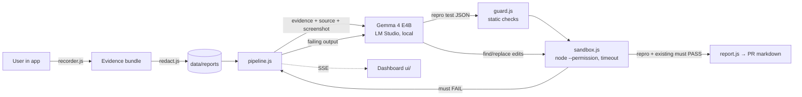

# RedGreen 🔴🟢

**Bug report → failing test → verified fix, on local Gemma 4. No proof, no fix.**

AI coding tools are good at *saying* they fixed a bug. RedGreen doesn't let them say it until it's proven:

1. A user hits a bug and clicks **Report bug**. A drop-in recorder attaches what actually happened: their action sequence and the state after each step, console errors, failed network requests, and an optional screenshot. Emails, tokens, auth headers and cookies are **redacted before anything is stored**.
2. **Gemma 4 (running locally in LM Studio)** reads the evidence (and the screenshot, using Gemma 4's vision) plus the source code, and writes **one test that replays the user's steps**.
3. RedGreen runs that test in a throwaway sandbox. It is only accepted if it **fails on the current code with an assertion error**. A test that passes, or crashes, is rejected and Gemma is told why. → 🔴 **RED: bug reproduced.**
4. Gemma proposes a minimal patch as exact find/replace edits. RedGreen applies it in a fresh sandbox and reruns **the same test and the existing suite**. → 🟢 **GREEN: fix verified.**
5. You get a PR description built only from real artifacts: cited evidence, the reproduction test, the diff, and the real before/after test output.

Everything runs on a laptop. With the default LM Studio endpoint, **no code or user data leaves the machine.**

## Why this is different

| | Typical AI fix tools | RedGreen |
|---|---|---|
| Input | Stack trace or issue text | Captured user session: actions + state, failed requests, console errors, screenshot |
| "Fixed" means | The model said so | The same test went red → green and the existing tests still pass |
| Where it runs | Cloud | Local Gemma 4 via LM Studio, offline |
| Generated code | Often run directly | Static allow-list check, then a sandbox using Node's permission model (no fs writes, no child processes, read-only access to the sandbox dir), 15s timeout, empty env, no shell |

## Where Gemma 4 does the work, and where it doesn't

| Gemma 4 (interpretation) | Deterministic code (facts) |
|---|---|
| Reads messy evidence + screenshot, forms a hypothesis, cites event ids | Recording, redaction, storage |
| Writes the reproduction test | Running tests, deciding red/green, exit codes |
| Proposes the minimal patch | Applying edits (exact unique match only), diffing, verification |
| Explains the root cause | Building the PR text from real outputs |

## Quick start (Windows / macOS / Linux, Node ≥ 20, no `npm install` needed)

1. **LM Studio** → download **Gemma 4 E4B** (Q4_K_M) → load it → Developer tab → **Start Server** (port 1234).
2. In this folder:
   ```bash
   npm run smoke     # proves Gemma 4 is reachable and returns structured JSON
   npm start         # RedGreen on http://localhost:3000, demo shop on http://localhost:3000/shop/
   ```
3. In the demo shop: add Headphones → set qty 3 → apply `SAVE20` → set qty 1 → Checkout (it fails) → **🐞 Report bug**.
4. In RedGreen: open the report → **Reproduce & fix with Gemma 4**.

Config (env vars): `GEMMA_BASE_URL` (default `http://localhost:1234/v1`), `GEMMA_MODEL` (default: auto-detects the loaded Gemma model), `GEMMA_API_KEY`, `GEMMA_TEMPERATURE`, `GEMMA_MAX_TOKENS`, `PORT`.

## Tests

```bash
npm test               # redaction, safety guard, JSON parsing, and a full pipeline run against a mock model
npm run check:sandbox  # proves a malicious "test" cannot write outside the sandbox
```

## Demo app (synthetic)

`fixtures/shop` is a **synthetic demo app with an intentionally planted bug**: the coupon discount is computed once, when the coupon is applied, and isn't recalculated when quantity changes. Its 5 existing tests all pass. `data/reports/rpt_sample.json` is a **scripted sample** report, generated by replaying real actions against the real cart module (`npm run sample`), and is labelled as such in the UI.

## Architecture



```
server.js            zero-dependency HTTP server + SSE
src/model.js         Gemma 4 client (OpenAI-compatible: LM Studio by default)
src/prompts.js       prompts + JSON schemas (evidence treated as untrusted data)
src/pipeline.js      red → green state machine with retry feedback
src/guard.js         allow-list for generated tests, safe find/replace patching
src/sandbox.js       isolated test runs
src/redact.js        secret/PII redaction
src/report.js        PR description from real artifacts
ui/                  dashboard
fixtures/shop/       synthetic demo app + recorder.js
```

## Safety & privacy

- Evidence is redacted (bearer tokens, API keys, JWTs, emails, card-like numbers, secret query params, `Authorization`/`Cookie` headers) **before** it is written to disk or sent to the model.
- Screenshots are attached only if the user chooses one, and are kept locally.
- Evidence is fenced as untrusted data in prompts; the model is told never to follow instructions inside it.
- Model-generated code never runs on the host directly: it goes through an import allow-list, then a temp copy, `node --permission` (read-only access to the sandbox, no child processes, no writes), a 15s timeout, an empty environment and no shell.
- RedGreen never claims a bug is reproduced or fixed unless the corresponding test run actually happened. The verdict comes from exit codes, not from the model.

## Limitations (honest)

- Today it targets JavaScript modules tested with `node:test`; the demo uses one fixture app.
- Patches are limited to one file and ≤ 6 exact edits.
- On Node < 22.13 the permission model is unavailable; the UI shows "no fs isolation".
- A small local model can fail to reproduce a bug. RedGreen then says "not reproduced" rather than guessing.

## Roadmap

GitHub issue → RedGreen run → draft PR · Playwright browser-level reproduction · Jest/Vitest/pytest runners · container sandbox.

## License

Apache-2.0
